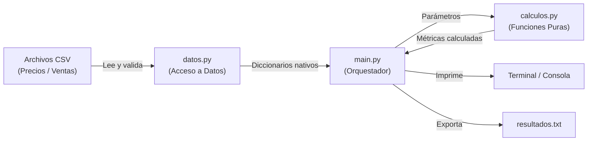
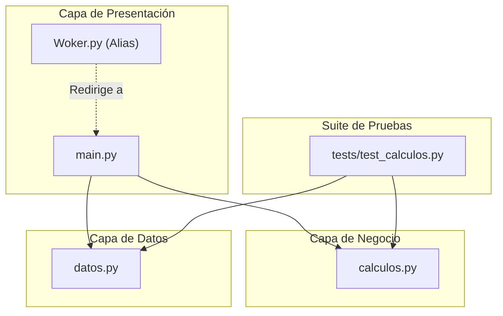
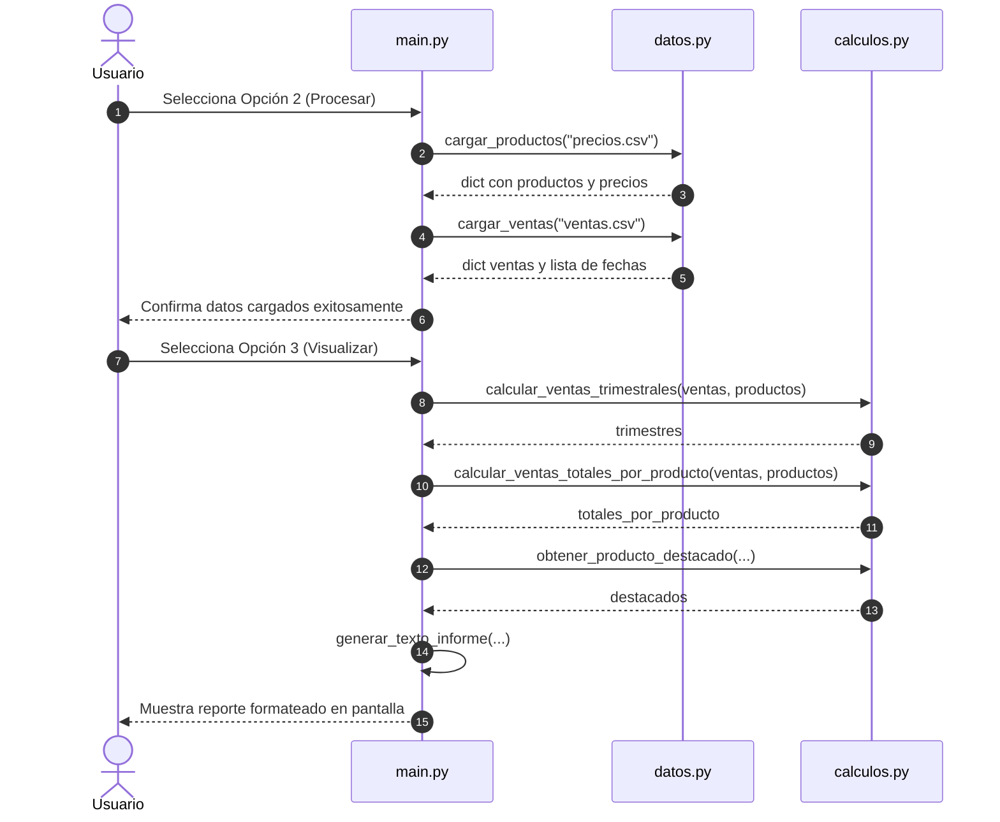

# Documento de Arquitectura y Diseño Técnico

Este documento detalla los principios de diseño, el flujo de datos y la organización modular del sistema.

---

## 1. Visión General y Filosofía de Diseño

El sistema sigue el principio de **Separación de Responsabilidades** (*Separation of Concerns*), dividiendo el flujo en tres etapas desacopladas:
1. **Acceso a datos (I/O)**: Lectura y parseo de archivos.
2. **Lógica de negocio**: Cálculos matemáticos y estadísticos a través de funciones puras.
3. **Presentación**: Interacción con el usuario y formateo de informes.

---

## 2. Mapa de Módulos y Dependencias

La jerarquía de dependencias es estrictamente unidireccional, garantizando que el núcleo de cálculo no dependa de la interfaz ni del sistema operativo:

> **Regla de dependencia**: `calculos.py` **no importa** a `datos.py` ni a `main.py`. Es un módulo 100% independiente y reutilizable en cualquier contexto (CLI, web, API o scripts automáticos).

---

## 3. Flujo de Ejecución (Diagrama de Secuencia)

El siguiente diagrama ilustra la interacción paso a paso cuando el usuario ejecuta la opción de procesar y visualizar:

---

## 4. Comparativa: Código Original vs. Código Refactorizado

| Dimensión | Código Original (`Woker.py`) | Código Refactorizado |
|---|---|---|
| **Gestión de Estado** | Variables `global` en múltiples funciones. | Parámetros explícitos y retorno de valores. |
| **I/O y Cálculos** | Mezclados: las funciones calculaban y hacían `print()` al mismo tiempo. | Desacoplados: `calculos.py` no produce efectos secundarios. |
| **Testeabilidad** | Imposible de testear con pruebas automáticas sin interceptar `stdout`. | Totalmente testeable en milisegundos con `unittest`. |
| **Portabilidad** | Usaba `os.system("cls")` exclusivo de Windows. | Detección dinámica de SO (`cls` en Windows / `clear` en Unix). |
| **Manejo de Errores** | El programa crasheaba si se seleccionaba la Opción 3 antes de la 2. | Menú defensivo que valida prerequisitos antes de ejecutar. |
